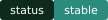
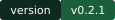
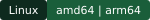
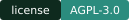
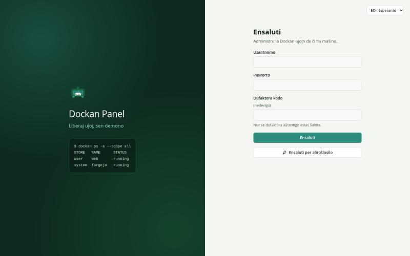
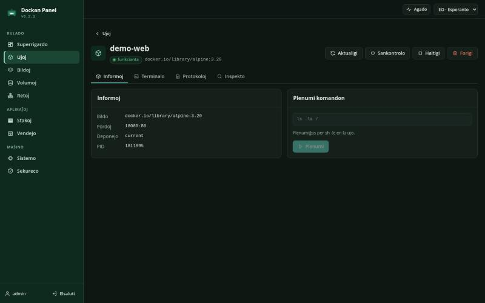
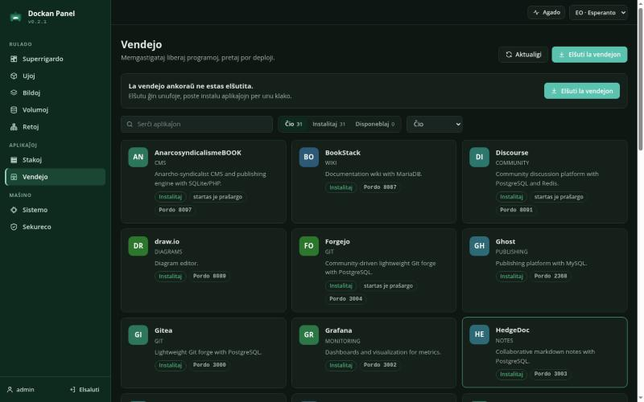

# Dockan Panel

<p align="center"></p>

Retpanelo por [Dockan](https://github.com/Dockan-Conteneurisation-libre/Dockan): ujoj, bildoj, volumoj, stakoj kaj vendejo de memgastigataj aplikaĵoj.
Unu statika Go-duumaĵo kun enkonstruita Vue-interfaco, sen PHP, sen demono, sen CDN.

    

**Esperanto** · [Français](docs/i18n/README.fr.md) · [English](docs/i18n/README.en.md) · [Español](docs/i18n/README.es.md)

Nuna versio: `v0.2.2`.

## Rapida starto

```bash
curl -fsSLO https://github.com/Dockan-Conteneurisation-libre/Dockan-Panel/releases/latest/download/dockan-panel-linux-amd64.tar.gz && tar -xzf dockan-panel-linux-amd64.tar.gz && ./dockan-panel/dockan-panel
```

Malfermu `http://127.0.0.1:9090`. Por la unua konto, la panelo petas **instalan kodon**: ĝi aperas en la protokolo de la panelo kaj en la dosiero `storage/setup-token`. Tiel neniu alia en la reto povas krei la administran konton antaŭ vi.

## Ekrankopioj

| Ensaluto | Ujo | Vendejo |
| --- | --- | --- |
|  |  |  |

## Funkcioj

| Parto | Kion ĝi faras |
| --- | --- |
| Superrigardo | Funkciantaj ujoj, bildoj, volumoj, retoj, stakoj, eligo de `dockan doctor` |
| Ujoj | Ĉiuj deponejoj (`--scope all`), lanĉo (`run -d`) kun pordoj, medio, volumoj, izolado, limoj |
| Ujo | Informoj, interaga terminalo (xterm.js), protokoloj, inspekto, unuopa komando |
| Bildoj | Elŝuto (ankaŭ `nomo@sha256:…`, privataj registrejoj), forigo |
| Volumoj | Kreo, forigo, savkopio kaj restarigo |
| Stakoj | Redaktilo de `dockan.yml`, starto, halto, redeplojo, sano, importo de bildoj; plenumo de ekzistanta compose-dosiero |
| Vendejo | Katalogo de la Dockan-vendejo, instalo, starto je praŝargo, ĝisdatigo de bildoj, agordo, alŝuto de statika retejo |
| Sistemo | Versioj, dependaĵoj, ĝisdatigo de Dockan kaj de la panelo (kontrolita per SHA256) |
| Sekureco | Kontoj, dufaktora aŭtentigo (TOTP), aliroŝlosiloj (WebAuthn) |

La interfaco ekzistas en esperanto, franca, angla kaj hispana, en hela kaj malhela reĝimoj, por komputilo kaj poŝtelefono.

## Kongrueco

| Elemento | Subtenata |
| --- | --- |
| Dockan | v0.2.5 kaj pli novaj |
| Sistemo | Linukso amd64 kaj arm64 (statika duumaĵo, sen dependaĵo) |
| Retumilo | Lastaj versioj de Firefox, Chromium, Safari; aliroŝlosiloj bezonas HTTPS aŭ `localhost` |
| Datumoj de la PHP-panelo | `auth-users.json` (bcrypt `$2y$`, TOTP, aliroŝlosiloj), stakoj, savkopioj kaj vendejo estas reuzataj senŝanĝe |

## Agordo

| Variablo | Defaŭlto | Rolo |
| --- | --- | --- |
| `BIND` | `0.0.0.0` | Aŭskulta adreso (`127.0.0.1` por nur loka aliro) |
| `PORT` | `9090` | Aŭskulta pordo |
| `DOCKAN_BIN` | `dockan` | Vojo al la `dockan`-duumaĵo |
| `PANEL_STORAGE` | `<dosierujo de la duumaĵo>/storage` | Kontoj, stakoj, savkopioj, vendejo |
| `PANEL_UPDATE_DIR` | dosierujo de la duumaĵo | Kien la panela ĝisdatigo instalas la novan version |

Seancoj restas en memoro: restarto de la panelo elsalutas ĉiujn.

## Kiel Dockan-servo

La eldona arĥivo enhavas `Dockanfile` kaj `dockan.yml`. En la servilo:

```bash
sudo mkdir -p /srv/dockan-panel && sudo tar -xzf dockan-panel-linux-amd64.tar.gz -C /srv --no-same-owner
sudo dockan compose autostart -f /srv/dockan-panel/dockan.yml --name dockan-panel
```

Por eksponi ĝin en interreto, metu ĝin malantaŭ HTTPS-inversan prokurilon kaj limigu la aliron. La panelo povas plenumi komandojn kiel root: neniam eksponu ĝin sen HTTPS.

## Migrado de la PHP-panelo (v0.2.0)

Vidu [docs/MIGRATION.md](docs/MIGRATION.md). La datumoj (`dockan-panel-data`) restas netuŝitaj.

## Arĥitekturo

```text
cmd/dockan-panel/     enirpunkto (HTTP-servilo, ĉesigo)
internal/api/         JSON-API, seancoj, CSRF, sekurecaj kapoj
internal/auth/        kontoj, bcrypt, TOTP, WebAuthn, limigo de provoj
internal/dockan/      legado de la eligoj de dockan
internal/runner/      plenumo de komandoj (sen ŝelo, aŭ citita skripto)
internal/stacks/      stakoj sub storage/stacks
internal/store/       vendejo kaj alŝuto de retejo (limigita per os.Root)
internal/system/      versioj, dependaĵoj, ĝisdatigoj
internal/terminal/    pseŭdoterminaloj por la interaga ŝelo
internal/webui/       la konstruita Vue-interfaco, enkonstruita per go:embed
web/                  Vue 3 + TypeScript + Tailwind (Vite)
deploy/               Dockanfile kaj dockan.yml
scripts/              versio kaj restarigo de datumoj
```

## Konstrui

```bash
make build    # npm ci, Vite, poste go build: ./dockan-panel
make test     # go vet, go test, vue-tsc, paritato de la tradukoj
make dist     # dist/dockan-panel-linux-{amd64,arm64}.tar.gz kaj SHA256SUMS
```

Necesas Go 1.26 kaj Node.js 22.

## Kontribui

Malfermu temon aŭ tirpeton. Ĉiu ŝanĝo devas pasi `make test`; ĉiu nova teksto de la interfaco aperas en la kvar lingvoj (`web/src/i18n/`).

## Permesilo

[GNU AGPL-3.0](LICENSE). Se vi provizas modifitan version de la panelo per reto, vi devas doni ĝian fontkodon al ĝiaj uzantoj.
