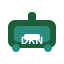
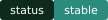
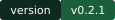
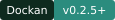
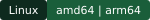
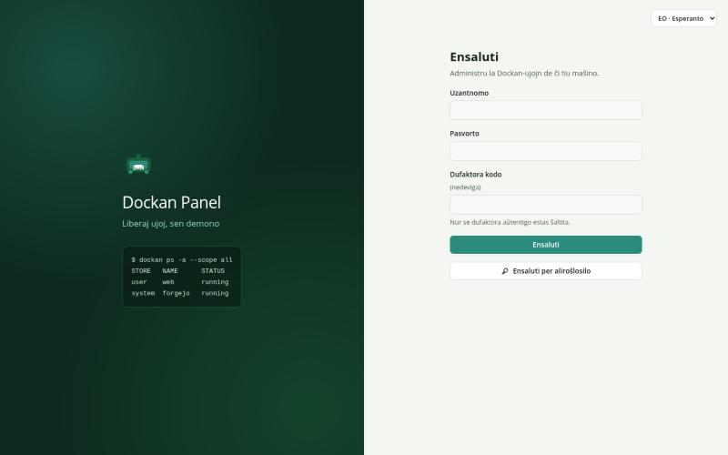
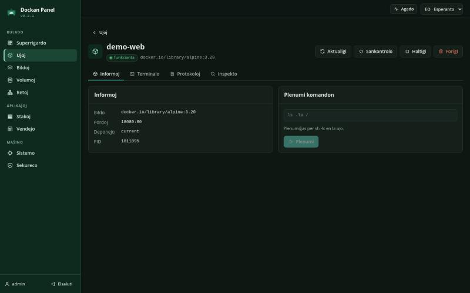
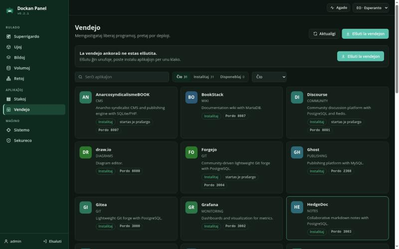

# Dockan Panel

<p align="center"></p>

Web panel for [Dockan](https://github.com/Dockan-Conteneurisation-libre/Dockan): containers, images, volumes, stacks and a store of self-hosted apps.
One static Go binary with the Vue interface built in: no PHP, no daemon, no CDN.

   

[Esperanto](../../README.md) · [Français](README.fr.md) · **English** · [Español](README.es.md)

Current version: `v0.2.1`.

## Quickstart

```bash
curl -fsSLO https://github.com/Dockan-Conteneurisation-libre/Dockan-Panel/releases/latest/download/dockan-panel-linux-amd64.tar.gz && tar -xzf dockan-panel-linux-amd64.tar.gz && ./dockan-panel/dockan-panel
```

Open `http://127.0.0.1:9090`. For the first account the panel asks for a **setup code**: it is printed in the panel log and saved in `storage/setup-token`. Nobody else on the network can create the admin account before you.

## Screenshots

| Sign-in | Container | Store |
| --- | --- | --- |
|  |  |  |

## Features

| Part | What it does |
| --- | --- |
| Overview | Running containers, images, volumes, networks, stacks, `dockan doctor` output |
| Containers | Every store (`--scope all`), start (`run -d`) with ports, environment, volumes, isolation, limits |
| Container | Information, interactive terminal (xterm.js), logs, inspect, one-off command |
| Images | Pull (including `name@sha256:…` and private registries), remove |
| Volumes | Create, remove, back up and restore |
| Stacks | `dockan.yml` editor, start, stop, redeploy, health, image import; run an existing compose file |
| Store | Dockan store catalog, install, start at boot, image updates, configuration, static site upload |
| System | Versions, dependencies, Dockan and panel updates (checked with SHA256) |
| Security | Accounts, two-factor authentication (TOTP), passkeys (WebAuthn) |

The interface is available in Esperanto, French, English and Spanish, in light and dark themes, on desktop and mobile.

## Compatibility

| Item | Supported |
| --- | --- |
| Dockan | v0.2.5 and later |
| System | Linux amd64 and arm64 (static binary, no dependency) |
| Browser | Recent Firefox, Chromium, Safari; passkeys need HTTPS or `localhost` |
| PHP panel data | `auth-users.json` (bcrypt `$2y$`, TOTP, passkeys), stacks, backups and store are reused as they are |

## Configuration

| Variable | Default | Role |
| --- | --- | --- |
| `BIND` | `0.0.0.0` | Listen address (`127.0.0.1` for local access only) |
| `PORT` | `9090` | Listen port |
| `DOCKAN_BIN` | `dockan` | Path of the `dockan` binary |
| `PANEL_STORAGE` | `<binary folder>/storage` | Accounts, stacks, backups, store |
| `PANEL_UPDATE_DIR` | binary folder | Where the panel update installs the new version |

Sessions live in memory: restarting the panel signs everyone out.

## As a Dockan service

The release archive contains `Dockanfile` and `dockan.yml`. On the server:

```bash
sudo mkdir -p /srv/dockan-panel && sudo tar -xzf dockan-panel-linux-amd64.tar.gz -C /srv --no-same-owner
sudo dockan compose autostart -f /srv/dockan-panel/dockan.yml --name dockan-panel
```

To expose it on the Internet, put it behind an HTTPS reverse proxy and restrict access. The panel can run commands as root: never expose it without HTTPS.

## Migrating from the PHP panel (v0.2.0)

See [MIGRATION.en.md](MIGRATION.en.md). The data (`dockan-panel-data`) is left untouched.

## Architecture

```text
cmd/dockan-panel/     entry point (HTTP server, clean shutdown)
internal/api/         JSON API, sessions, CSRF, security headers
internal/auth/        accounts, bcrypt, TOTP, WebAuthn, attempt limits
internal/dockan/      parsing of dockan output
internal/runner/      command execution (no shell, or a quoted script)
internal/stacks/      stacks under storage/stacks
internal/store/       store and site upload (confined with os.Root)
internal/system/      versions, dependencies, updates
internal/terminal/    pseudo-terminals for the interactive shell
internal/webui/       built Vue interface, embedded with go:embed
web/                  Vue 3 + TypeScript + Tailwind (Vite)
deploy/               Dockanfile and dockan.yml
scripts/              version and data restore
```

## Build

```bash
make build    # npm ci, Vite, then go build: ./dockan-panel
make test     # go vet, go test, vue-tsc, translation parity
make dist     # dist/dockan-panel-linux-{amd64,arm64}.tar.gz and SHA256SUMS
```

Requires Go 1.26 and Node.js 22.

## Contributing

Open an issue or a pull request. Every change must pass `make test`; every new interface text is added in the four languages (`web/src/i18n/`).
