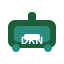
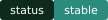
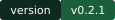
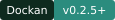
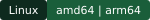
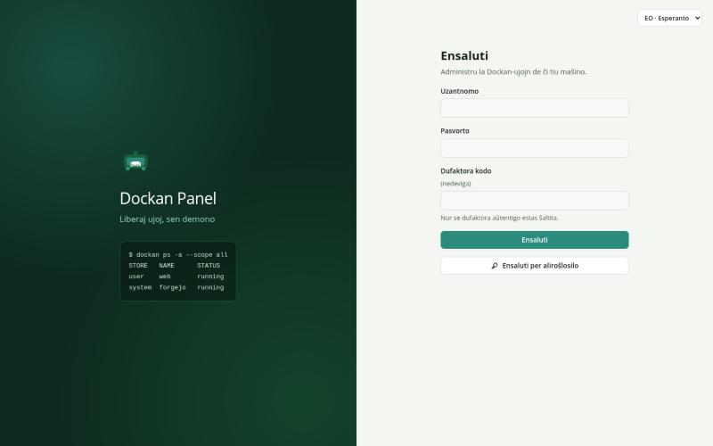
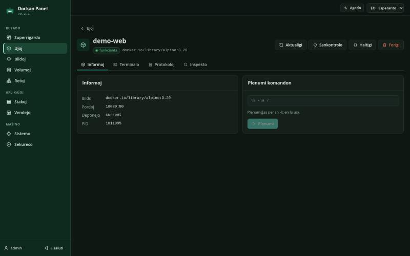
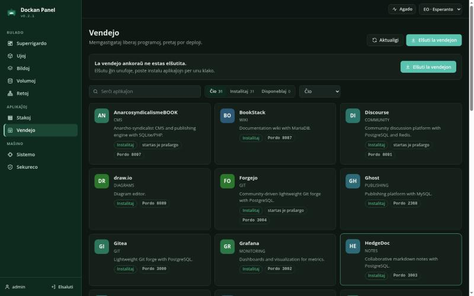

# Dockan Panel

<p align="center"></p>

Panel web para [Dockan](https://github.com/Dockan-Conteneurisation-libre/Dockan): contenedores, imágenes, volúmenes, stacks y una tienda de aplicaciones autoalojadas.
Un solo binario Go estático con la interfaz Vue integrada: sin PHP, sin demonio, sin CDN.

   

[Esperanto](../../README.md) · [Français](README.fr.md) · [English](README.en.md) · **Español**

Versión actual: `v0.2.1`.

## Inicio rápido

```bash
curl -fsSLO https://github.com/Dockan-Conteneurisation-libre/Dockan-Panel/releases/latest/download/dockan-panel-linux-amd64.tar.gz && tar -xzf dockan-panel-linux-amd64.tar.gz && ./dockan-panel/dockan-panel
```

Abre `http://127.0.0.1:9090`. Para la primera cuenta, el panel pide un **código de instalación**: aparece en el registro del panel y en el archivo `storage/setup-token`. Así nadie más en la red puede crear la cuenta de administración antes que tú.

## Capturas

| Inicio de sesión | Contenedor | Tienda |
| --- | --- | --- |
|  |  |  |

## Funciones

| Parte | Qué hace |
| --- | --- |
| Resumen | Contenedores en marcha, imágenes, volúmenes, redes, stacks, salida de `dockan doctor` |
| Contenedores | Todos los almacenes (`--scope all`), lanzamiento (`run -d`) con puertos, entorno, volúmenes, aislamiento, límites |
| Contenedor | Información, terminal interactivo (xterm.js), registros, inspección, comando puntual |
| Imágenes | Descarga (también `nombre@sha256:…` y registros privados), eliminación |
| Volúmenes | Creación, eliminación, copia de seguridad y restauración |
| Stacks | Editor de `dockan.yml`, inicio, parada, redespliegue, salud, importación de imágenes; ejecución de un archivo compose existente |
| Tienda | Catálogo de la tienda Dockan, instalación, arranque al iniciar, actualización de imágenes, configuración, subida de un sitio estático |
| Sistema | Versiones, dependencias, actualización de Dockan y del panel (comprobada con SHA256) |
| Seguridad | Cuentas, autenticación de dos factores (TOTP), llaves de acceso (WebAuthn) |

La interfaz existe en esperanto, francés, inglés y español, en tema claro y oscuro, en ordenador y móvil.

## Compatibilidad

| Elemento | Soportado |
| --- | --- |
| Dockan | v0.2.5 y posteriores |
| Sistema | Linux amd64 y arm64 (binario estático, sin dependencias) |
| Navegador | Versiones recientes de Firefox, Chromium, Safari; las llaves de acceso necesitan HTTPS o `localhost` |
| Datos del panel PHP | `auth-users.json` (bcrypt `$2y$`, TOTP, llaves de acceso), stacks, copias y tienda se reutilizan tal cual |

## Configuración

| Variable | Por defecto | Función |
| --- | --- | --- |
| `BIND` | `0.0.0.0` | Dirección de escucha (`127.0.0.1` para acceso solo local) |
| `PORT` | `9090` | Puerto de escucha |
| `DOCKAN_BIN` | `dockan` | Ruta del binario `dockan` |
| `PANEL_STORAGE` | `<carpeta del binario>/storage` | Cuentas, stacks, copias, tienda |
| `PANEL_UPDATE_DIR` | carpeta del binario | Dónde instala la actualización del panel la nueva versión |

Las sesiones viven en memoria: reiniciar el panel cierra todas las sesiones.

## Como servicio Dockan

El archivo de la versión contiene `Dockanfile` y `dockan.yml`. En el servidor:

```bash
sudo mkdir -p /srv/dockan-panel && sudo tar -xzf dockan-panel-linux-amd64.tar.gz -C /srv --no-same-owner
sudo dockan compose autostart -f /srv/dockan-panel/dockan.yml --name dockan-panel
```

Para exponerlo en Internet, ponlo detrás de un proxy inverso HTTPS y restringe el acceso. El panel puede ejecutar comandos como root: nunca lo expongas sin HTTPS.

## Migración desde el panel PHP (v0.2.0)

Consulta [MIGRATION.es.md](MIGRATION.es.md). Los datos (`dockan-panel-data`) no se tocan.

## Arquitectura

```text
cmd/dockan-panel/     punto de entrada (servidor HTTP, parada limpia)
internal/api/         API JSON, sesiones, CSRF, cabeceras de seguridad
internal/auth/        cuentas, bcrypt, TOTP, WebAuthn, límite de intentos
internal/dockan/      lectura de la salida de dockan
internal/runner/      ejecución de comandos (sin shell, o script citado)
internal/stacks/      stacks en storage/stacks
internal/store/       tienda y subida de sitio (confinada con os.Root)
internal/system/      versiones, dependencias, actualizaciones
internal/terminal/    pseudoterminales para el shell interactivo
internal/webui/       interfaz Vue compilada, integrada con go:embed
web/                  Vue 3 + TypeScript + Tailwind (Vite)
deploy/               Dockanfile y dockan.yml
scripts/              versión y restauración de datos
```

## Compilar

```bash
make build    # npm ci, Vite y luego go build: ./dockan-panel
make test     # go vet, go test, vue-tsc, paridad de traducciones
make dist     # dist/dockan-panel-linux-{amd64,arm64}.tar.gz y SHA256SUMS
```

Necesita Go 1.26 y Node.js 22.

## Contribuir

Abre una incidencia o una solicitud de fusión. Cada cambio debe pasar `make test`; todo texto nuevo de la interfaz se añade en los cuatro idiomas (`web/src/i18n/`).
