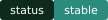
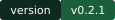
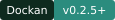
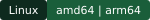
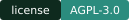
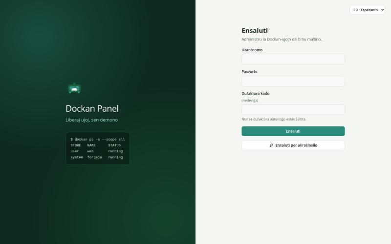
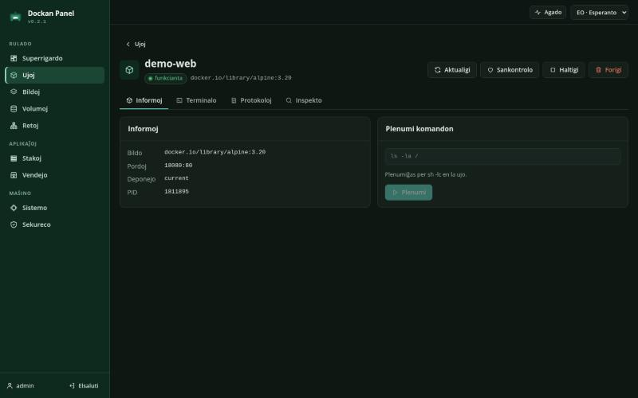
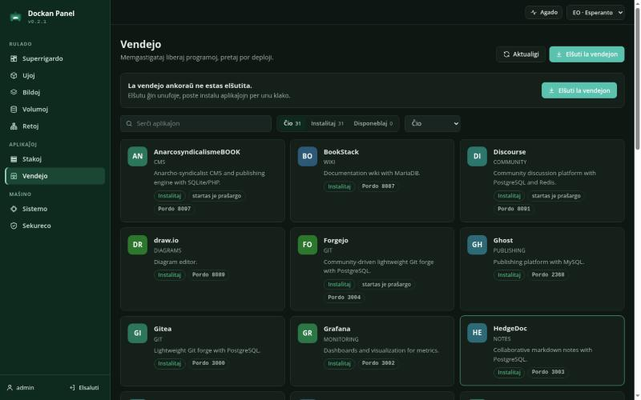

# Dockan Panel

<p align="center"></p>

Panneau web pour [Dockan](https://github.com/Dockan-Conteneurisation-libre/Dockan) : conteneurs, images, volumes, stacks et store d'applications auto-hébergées.
Un seul binaire Go statique avec l'interface Vue intégrée, sans PHP, sans démon, sans CDN.

    

[Esperanto](../../README.md) · **Français** · [English](README.en.md) · [Español](README.es.md)

Version actuelle : `v0.2.2`.

## Démarrage rapide

```bash
curl -fsSLO https://github.com/Dockan-Conteneurisation-libre/Dockan-Panel/releases/latest/download/dockan-panel-linux-amd64.tar.gz && tar -xzf dockan-panel-linux-amd64.tar.gz && ./dockan-panel/dockan-panel
```

Ouvrez `http://127.0.0.1:9090`. Pour le premier compte, le panneau demande un **code d'installation** : il s'affiche dans le journal du panneau et dans le fichier `storage/setup-token`. Ainsi, personne d'autre sur le réseau ne peut créer le compte d'administration avant vous.

## Captures

| Connexion | Conteneur | Store |
| --- | --- | --- |
|  |  |  |

## Fonctionnalités

| Partie | Ce qu'elle fait |
| --- | --- |
| Vue d'ensemble | Conteneurs en marche, images, volumes, réseaux, stacks, sortie de `dockan doctor` |
| Conteneurs | Tous les magasins (`--scope all`), lancement (`run -d`) avec ports, environnement, volumes, isolation, limites |
| Conteneur | Informations, terminal interactif (xterm.js), journaux, inspection, commande ponctuelle |
| Images | Téléchargement (y compris `nom@sha256:…`, registres privés), suppression |
| Volumes | Création, suppression, sauvegarde et restauration |
| Stacks | Éditeur de `dockan.yml`, démarrage, arrêt, redéploiement, santé, import d'images ; exécution d'un fichier compose existant |
| Store | Catalogue du store Dockan, installation, démarrage au boot, mise à jour des images, configuration, envoi d'un site statique |
| Système | Versions, dépendances, mise à jour de Dockan et du panneau (vérifiée par SHA256) |
| Sécurité | Comptes, authentification à deux facteurs (TOTP), clés d'accès (WebAuthn) |

L'interface existe en espéranto, français, anglais et espagnol, en thème clair et sombre, sur ordinateur et mobile.

## Compatibilité

| Élément | Pris en charge |
| --- | --- |
| Dockan | v0.2.5 et suivantes |
| Système | Linux amd64 et arm64 (binaire statique, sans dépendance) |
| Navigateur | Versions récentes de Firefox, Chromium, Safari ; les clés d'accès demandent HTTPS ou `localhost` |
| Données du panneau PHP | `auth-users.json` (bcrypt `$2y$`, TOTP, clés d'accès), stacks, sauvegardes et store sont repris tels quels |

## Configuration

| Variable | Défaut | Rôle |
| --- | --- | --- |
| `BIND` | `0.0.0.0` | Adresse d'écoute (`127.0.0.1` pour un accès local seulement) |
| `PORT` | `9090` | Port d'écoute |
| `DOCKAN_BIN` | `dockan` | Chemin du binaire `dockan` |
| `PANEL_STORAGE` | `<dossier du binaire>/storage` | Comptes, stacks, sauvegardes, store |
| `PANEL_UPDATE_DIR` | dossier du binaire | Où la mise à jour du panneau installe la nouvelle version |

Les sessions restent en mémoire : un redémarrage du panneau déconnecte tout le monde.

## En service Dockan

L'archive de version contient `Dockanfile` et `dockan.yml`. Sur le serveur :

```bash
sudo mkdir -p /srv/dockan-panel && sudo tar -xzf dockan-panel-linux-amd64.tar.gz -C /srv --no-same-owner
sudo dockan compose autostart -f /srv/dockan-panel/dockan.yml --name dockan-panel
```

Pour l'exposer sur Internet, placez-le derrière un proxy inverse HTTPS et restreignez l'accès. Le panneau peut exécuter des commandes en root : ne l'exposez jamais sans HTTPS.

## Migration depuis le panneau PHP (v0.2.0)

Voir [MIGRATION.fr.md](MIGRATION.fr.md). Les données (`dockan-panel-data`) ne sont pas touchées.

## Architecture

```text
cmd/dockan-panel/     point d'entrée (serveur HTTP, arrêt propre)
internal/api/         API JSON, sessions, CSRF, en-têtes de sécurité
internal/auth/        comptes, bcrypt, TOTP, WebAuthn, limitation des tentatives
internal/dockan/      lecture des sorties de dockan
internal/runner/      exécution des commandes (sans shell, ou script cité)
internal/stacks/      stacks sous storage/stacks
internal/store/       store et envoi de site (confiné par os.Root)
internal/system/      versions, dépendances, mises à jour
internal/terminal/    pseudo-terminaux du shell interactif
internal/webui/       interface Vue compilée, intégrée par go:embed
web/                  Vue 3 + TypeScript + Tailwind (Vite)
deploy/               Dockanfile et dockan.yml
scripts/              version et restauration des données
```

## Compiler

```bash
make build    # npm ci, Vite, puis go build : ./dockan-panel
make test     # go vet, go test, vue-tsc, parité des traductions
make dist     # dist/dockan-panel-linux-{amd64,arm64}.tar.gz et SHA256SUMS
```

Il faut Go 1.26 et Node.js 22.

## Contribuer

Ouvrez un ticket ou une demande de fusion. Chaque changement doit passer `make test` ; tout nouveau texte d'interface est ajouté dans les quatre langues (`web/src/i18n/`).

## Licence

[GNU AGPL-3.0](../../LICENSE). Si vous proposez une version modifiée du panneau sur un réseau, vous devez en fournir le code source à ses utilisatrices et utilisateurs.
